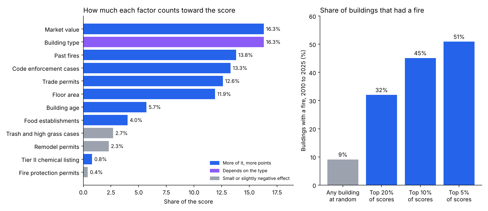

# Fire Inspection Risk Scoring

This project ranks corporate buildings in a city by how likely they are to have a fire, so inspectors can visit the riskiest buildings first. The city does not publish inspection pass or fail results, so the score is based on fire history from 2010 to 2025.

The underlying records are city data, so they are not in this repository. Nothing here includes addresses or place names.

## How it works

Each building earns points for 12 factors. The points add up, and the buildings with the most points are ranked as the highest risk. This is a simple regression: every factor has one weight, and a higher score means more risk.

The weights were fitted on 3,187 corporate buildings. Of those, 291 (9.1%) had a fire between 2010 and 2025.

## The 12 factors

| Factor | Share of the score | Effect |
|---|---|---|
| Market value | 16.3% | More value, more points |
| Building type | 16.3% | Convenience stores, senior living, hospitals and hotels add the most. Offices and medical offices subtract. |
| Past fires | 13.8% | More past fires, more points |
| Code enforcement cases | 13.3% | More cases, more points |
| Trade permits | 12.6% | More permits, more points |
| Floor area | 11.9% | Larger buildings, more points |
| Building age | 5.7% | Older buildings, more points |
| Food establishments | 4.0% | Commercial cooking on site adds points |
| Trash and high grass cases | 2.7% | Small effect |
| Remodel permits | 2.3% | Small effect |
| Tier II chemical listing | 0.8% | Listed buildings add points |
| Fire protection permits | 0.4% | Almost no effect |

## How well it works

Each building was scored by a model that had not seen it. Among the 5% of buildings with the highest scores, 51% had a fire, compared with 9% for a randomly chosen building. That is about 5.6 times as often.

| Highest scoring buildings | Share that had a fire |
|---|---|
| Top 5% (159 buildings) | 51% |
| Top 10% (319 buildings) | 45% |
| Top 20% (637 buildings) | 32% |
| Any building at random | 9% |

Most of the signal comes from size, value and building type. Using only those three factors already gets most of the way there.

## Limits

- The score predicts fire risk, not whether a building will pass or fail an inspection. Once the city's inspection records are available, the weights can be refit against real inspection results.
- About 1 in 3 fires could not be matched to a building, and 2021 and 2022 are missing, so past fire counts are a minimum.
- Larger and more valuable buildings have more fires on record partly because they have more space and more people.
- Trash cases and remodel permits have small negative weights. That is not evidence that they reduce risk.
- The factors were chosen using the same fires the model is tested on, so the results are somewhat optimistic.
