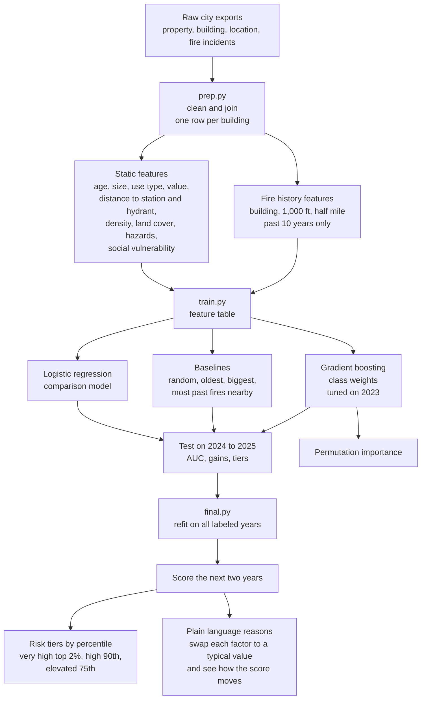
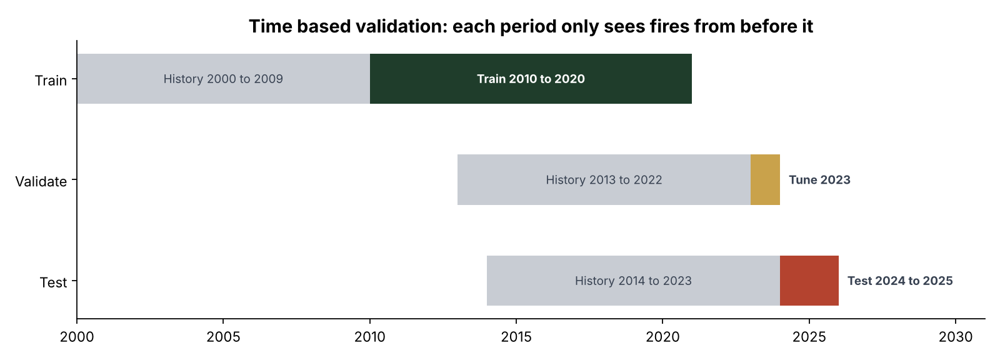
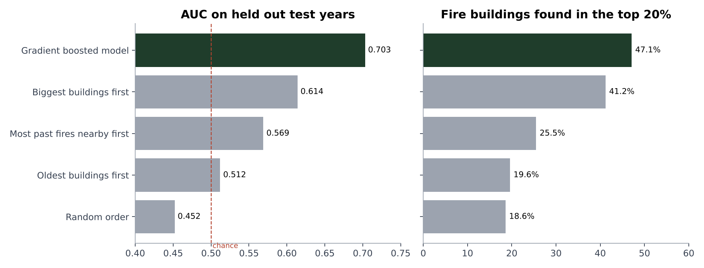
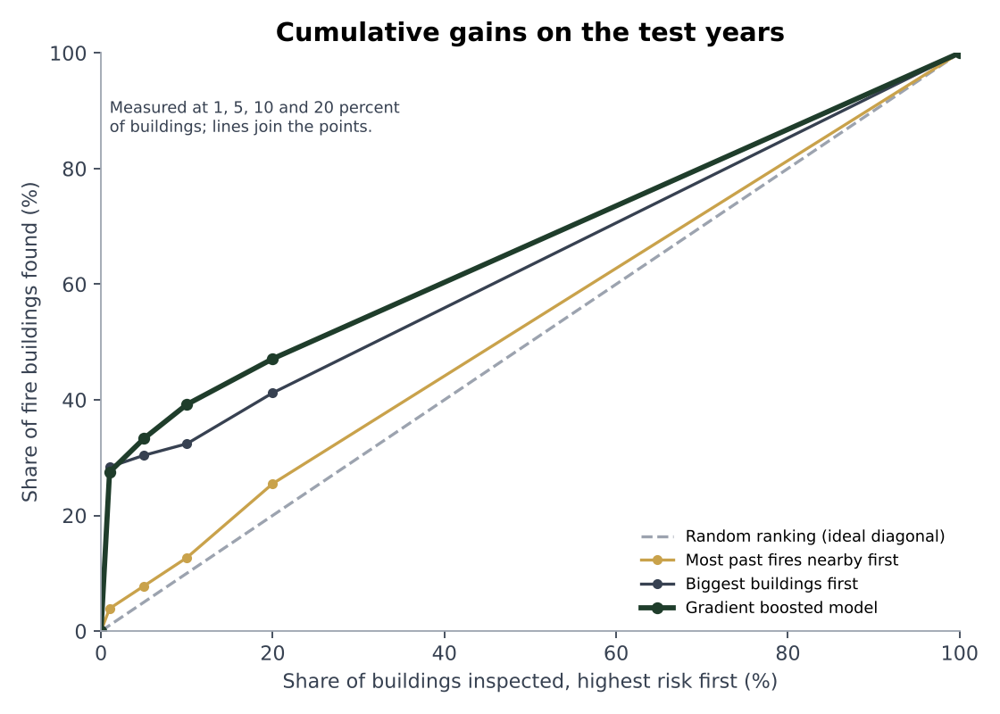
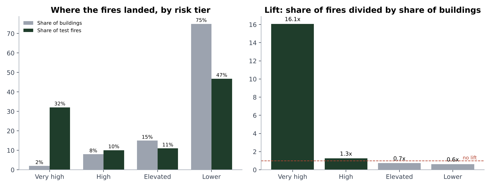
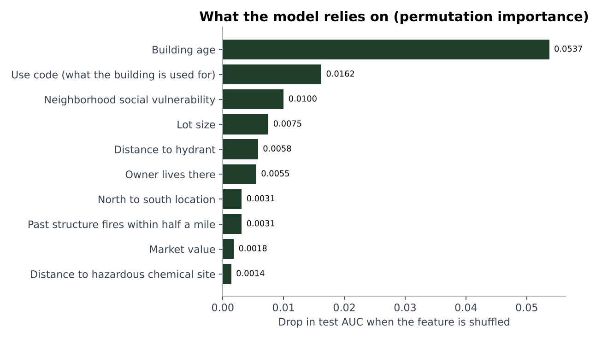
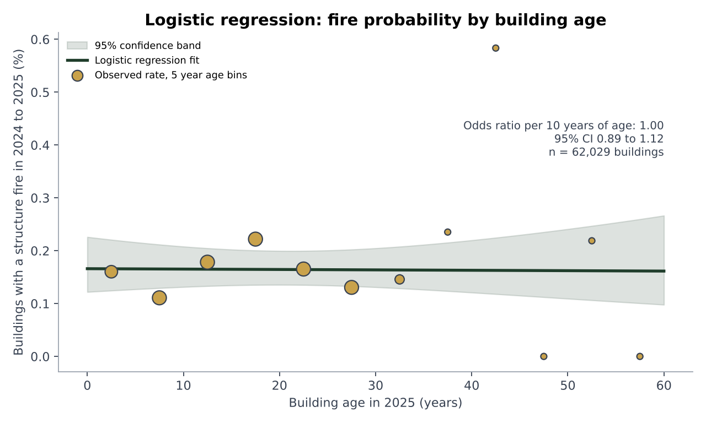
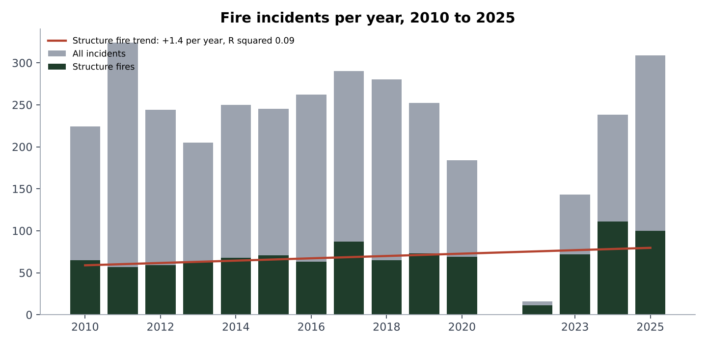
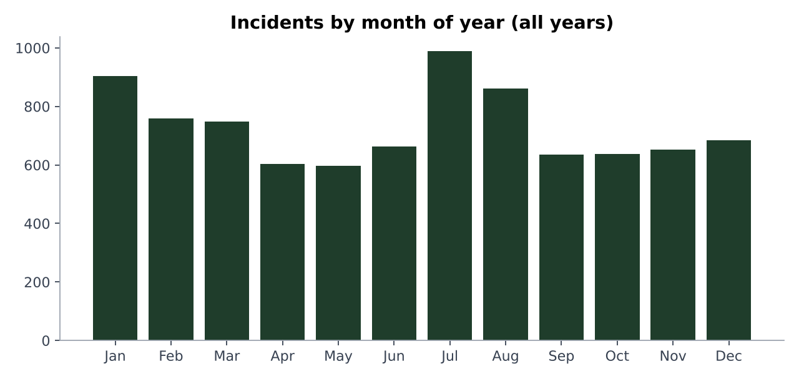

# Fire Risk Modeling

Built as part of a research project with Southern Methodist University (SMU). A machine learning model that scores how likely each building is to have a structure fire, built from municipal property, inspection and fire incident records from 2010 to 2025. The goal is to help a city decide where limited inspection hours do the most good.

The scoring and validation code is here. The underlying records are not, because they are city data. Every chart below is drawn from aggregate results only, with no addresses, coordinates or place names.

## At a glance

| | |
|---|---|
| Buildings scored | about 62,000 |
| Fire buildings in the test period | 102 (109 fires) |
| Test AUC | 0.703, and 0.703 again on the validation year |
| Top 5% of the ranking catches | 33.3% of fire buildings |
| "Very high" tier | 2% of buildings, 32% of fires, 16 times lift |
| Model | gradient boosted trees (scikit learn `HistGradientBoostingClassifier`) |

## Pipeline flow chart



## Validation design

The model is tested the way it would be used: it only ever sees the past. History features for any period use only fires that happened before that period, so nothing leaks from the future.



| Period | Role | Fire history window |
|---|---|---|
| 2010 to 2020 | Train | the 10 years before each year |
| 2023 | Validate and tune | 2013 to 2022 |
| 2024 to 2025 | Test | 2014 to 2023 |

## Results on the held out test years



| Ranking method | AUC | Fire buildings in top 5% | Fire buildings in top 20% |
|---|---|---|---|
| Random order | 0.452 | 3.9% | 18.6% |
| Oldest buildings first | 0.512 | 2.9% | 19.6% |
| Most past fires nearby first | 0.569 | 7.8% | 25.5% |
| Biggest buildings first | 0.614 | 30.4% | 41.2% |
| **Gradient boosted model** | **0.703** | **33.3%** | **47.1%** |

The random order row lands under 0.5 only because only 102 buildings had fires, so a single random shuffle is noisy. The validation year gives the same 0.703, so the result holds across two separate periods.

### Cumulative gains

If inspectors worked down the ranked list, how many of the fire buildings would they reach first? Points are measured at the top 1, 5, 10 and 20 percent.



| Share of buildings inspected | Fire buildings found, model | Biggest buildings first |
|---|---|---|
| 1% | 27.5% | 28.4% |
| 5% | 33.3% | 30.4% |
| 10% | 39.2% | 32.4% |
| 20% | 47.1% | 41.2% |

Size alone is a strong baseline at the very top. The model pulls ahead as the list gets longer.

### Risk tiers



The "very high" tier holds 1,238 buildings, about 2%, and 30 of them had a fire. That is 32% of all test period fires. The lower tiers are not perfectly ordered: the elevated tier did slightly worse than its size would predict, which is the kind of noise you expect when only 102 buildings are positive.

## What drives the score



Permutation importance measures how much test AUC drops when one feature is shuffled. Building age is the largest by a wide margin, followed by use type, neighborhood social vulnerability, lot size and distance to the nearest hydrant. Fire history nearby matters, but less than static building traits.

## Regression analysis

I used two simple regressions as a sanity check on the boosted model, using the exported aggregate tables.

### Logistic regression: fire probability against building age



A one variable logistic regression across 62,029 buildings gives an odds ratio of 1.00 per ten years of age, with a 95% confidence interval of 0.89 to 1.12. Age on its own, as a straight line, explains almost nothing. Yet age is the top feature in the boosted model. The two facts fit together: the boosted model uses age in combination with use type, size and value, which a single line cannot capture. That gap is the reason to use trees here instead of a plain regression.

### Linear regression: fires per year



An ordinary least squares fit on structure fires per year from 2010 to 2025 gives a slope of +1.4 fires per year with R squared 0.09. That is a weak trend. The sharp dip in 2021 looks like a records gap rather than a real drop, so I treat the slope as indicative only and do not feed year into the model.

### Seasonality



## What I took from it

- Fires are rare, so accuracy is the wrong metric. I used AUC, average precision and how many fire buildings land in the top slice of the ranking.
- Building size alone is a strong baseline, and I kept it in the comparison. The model beats it, but the margin is modest, which is the honest answer for a problem this noisy.
- A simple regression and a boosted model can disagree, and the disagreement is informative. Age looks flat in a line and dominant in trees.
- With 102 positives, tier level results are noisy. I report counts next to percentages so the sample size is visible.
- Time based splits matter. Random splits would leak future fire history into training and inflate the score.

## Run it yourself

The real records are private, so there is a demo on fully synthetic data that runs the same idea end to end: fake buildings and fire years, history features built from earlier years only, training on the past, testing on the future, and a comparison with a size baseline.

```
pip install -r requirements.txt
python demo/risk_demo.py
pytest
```

The tests check that history features never use fires from the future, that the model beats random and the size baseline on the synthetic data, and that the top slice metric behaves correctly. A GitHub Actions workflow runs them on every push.

## Files

- `model/prep.py` builds the building table and fire history from the raw exports
- `model/train.py` builds features, runs baselines, tunes and compares gradient boosting with logistic regression, and computes permutation importance
- `model/final.py` trains the evaluated model, refits on all labeled years, scores the next two years and generates reasons for each score
- `demo/risk_demo.py` runs the pipeline on synthetic data
- `tests/` holds the tests
- `docs/images/` holds the charts above

## Stack

Python, pandas, NumPy, SciPy, scikit learn, matplotlib
